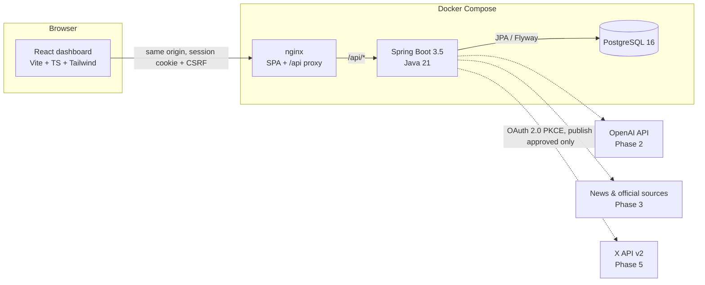
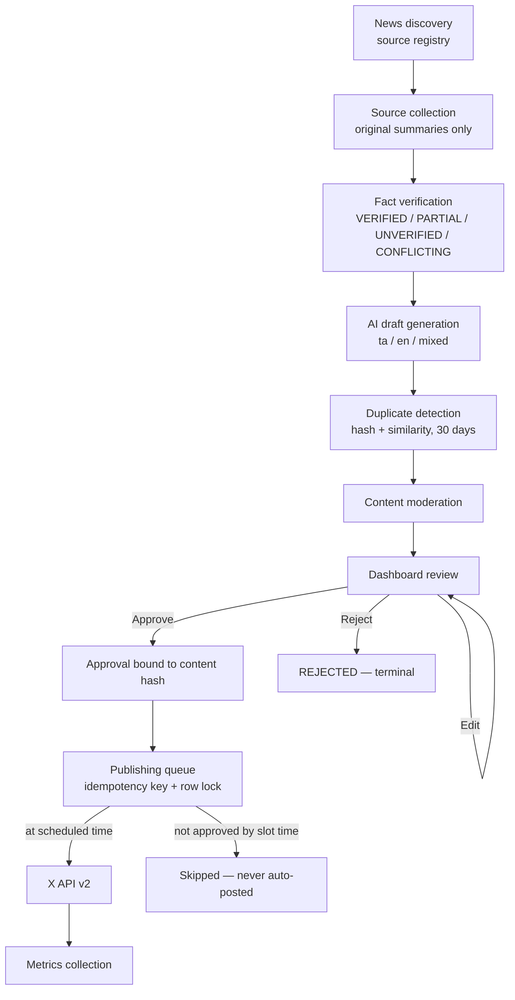
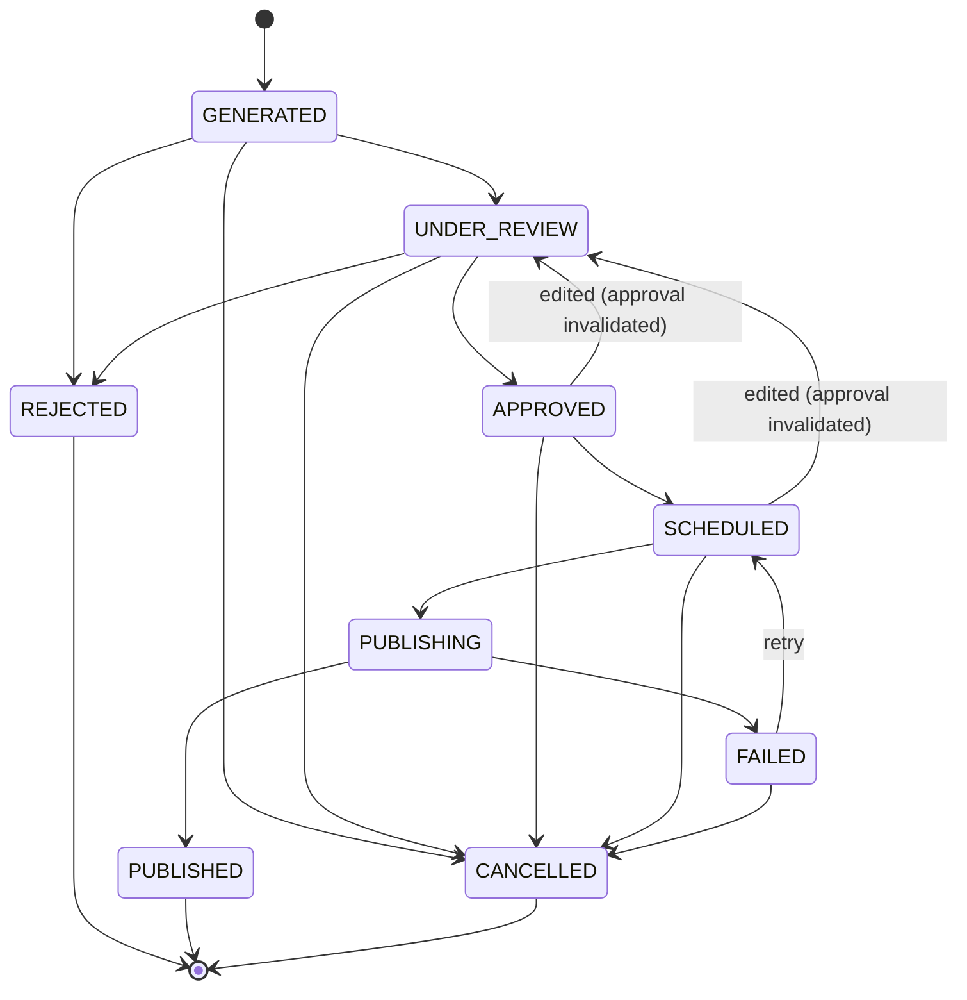
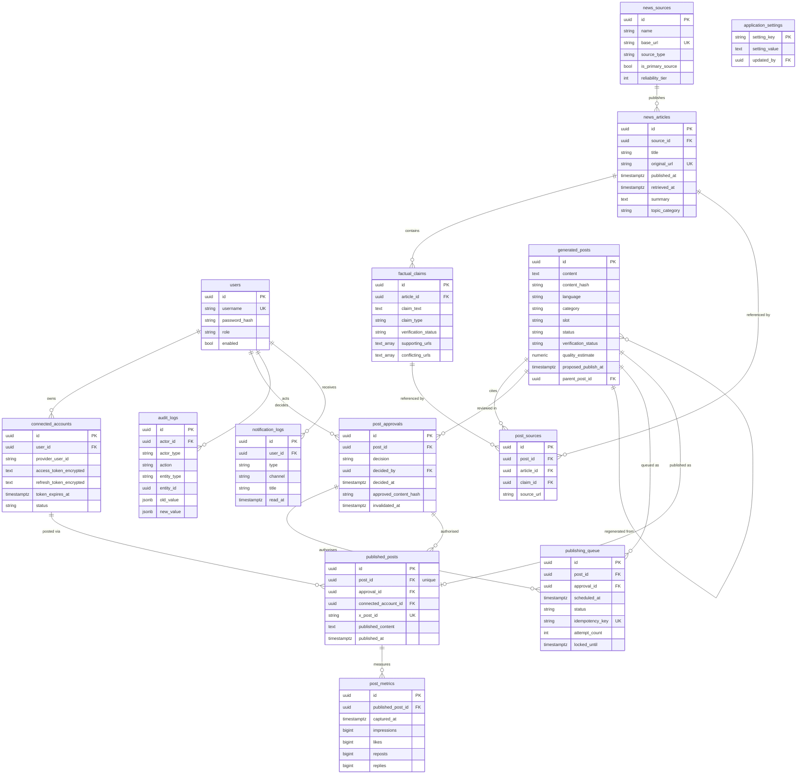
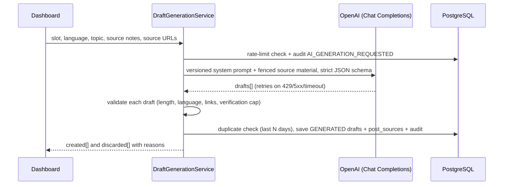
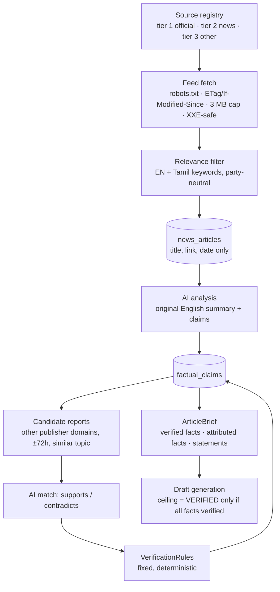

# Architecture — X Content Bot

Human-in-the-loop platform that drafts Tamil Nadu politics and governance posts with AI, checks them against sources, and publishes to X **only after explicit human approval**.

Status: **Phase 3 complete**: foundation, auth, settings, dashboard, AI draft generation, news discovery and cross-source fact-checking. Migrations V2 and V3 added draft review fields and news pipeline fields.

---

## 1. System overview



Browser and API share one origin through nginx, so the session cookie and CSRF cookie work without CORS. In local development, Vite proxies `/api` to `localhost:8080` to the same effect.

## 2. Content pipeline (target state)



## 3. Draft lifecycle

Enforced in code by `PostStatusPolicy` (every status change goes through `GeneratedPost.transitionTo`) and backed by database constraints.



### "Never publish without approval" — layered guarantees

| Layer | Guard |
|---|---|
| Domain | Only `SCHEDULED` can enter `PUBLISHING`; only `APPROVED`/`FAILED` can enter `SCHEDULED`. `REJECTED`, `PUBLISHED`, `CANCELLED` are terminal. |
| Approval binding | `post_approvals.approved_content_hash` stores the SHA-256 of the normalised text. Phase 5 publisher re-hashes before sending; any mismatch aborts. Editing invalidates the approval. |
| Database | `publishing_queue.approval_id NOT NULL`; at most one live approval per post (partial unique index); at most one active queue row per post; `published_posts.post_id UNIQUE`. |
| Config | `publishing.enabled` master switch, **off** by default. |
| Audit | `audit_logs` is append-only (trigger blocks UPDATE/DELETE). |

## 4. Module layout

```
backend/src/main/java/com/ai/xbot/
  config/        AppProperties (typed env config), Clock
  controller/    REST controllers (thin)
  service/       Business logic; service/workflow = PostStatusPolicy
  repository/    Spring Data JPA
  entity/        JPA entities + enums
  dto/           Request/response records
  security/      Spring Security, user details, admin bootstrap, login audit
  exception/     ApiError + GlobalExceptionHandler
  audit/         AuditService
  integration/openai, integration/xapi, news, scheduler   ← Phase 2/3/5/6
```

Module mapping from the spec: authentication / user-management → `security`; ai-content-generation → `integration/openai` + `service`; news-discovery, source-verification → `news`; content-approval / moderation → `service/workflow`; content-scheduling → `scheduler`; x-integration → `integration/xapi`; audit-logging → `audit`.

## 5. Database ER diagram

All primary keys are UUID. Timestamps are `TIMESTAMPTZ` stored in UTC; display uses the configured timezone (Asia/Kolkata by default).



Notes:
- **Generated vs approved vs published** are three separate tables, so the exact text that was approved and the exact text sent to X are both preserved.
- `post_metrics` columns are nullable: a metric X does not return stays `NULL`, never `0`.
- `news_articles.summary` holds an original summary; article bodies are never stored.
- Optimistic locking (`version`) on users, settings, drafts, claims, accounts and queue rows.

## 6. API (Phase 1)

Base path `/api`. All endpoints except login, CSRF priming and health require a session. State-changing requests require the `X-XSRF-TOKEN` header matching the `XSRF-TOKEN` cookie. Errors use one shape:

```json
{ "timestamp": "...", "status": 400, "error": "Bad Request",
  "message": "Validation failed", "path": "/api/settings/schedule",
  "fieldErrors": [{ "field": "morning", "message": "must be HH:mm (24h)" }] }
```

| Method | Path | Auth | Description |
|---|---|---|---|
| GET | `/api/auth/csrf` | public | Sets the `XSRF-TOKEN` cookie |
| POST | `/api/auth/login` | public + CSRF | Form fields `username`, `password`. 200 or 401 |
| POST | `/api/auth/logout` | session + CSRF | 204 |
| GET | `/api/auth/me` | session | Current user `{id, username, displayName, role}` |
| GET | `/api/dashboard/overview` | session | Counts by status, pending approvals, next 5 scheduled posts |
| GET | `/api/settings/schedule` | session | `{timezone, morning, afternoon, evening}` |
| PUT | `/api/settings/schedule` | ADMIN + CSRF | Validates HH:mm, distinct slots, known timezone. Audited |
| GET | `/api/settings/content` | session | `{enabledLanguages, languageMix, variationsPerTopic, duplicateLookbackDays}` |
| PUT | `/api/settings/content` | ADMIN + CSRF | Languages ⊆ {ta, en, mixed}; mix keys = enabled; total 100. Audited |
| GET | `/api/system/status` | session | Integration readiness flags. Never returns secret values |
| GET | `/api/audit?limit=50` | session | Most recent audit entries (max 200) |
| GET | `/actuator/health` | public | Liveness/readiness |
| POST | `/api/drafts/generate` | ADMIN/REVIEWER + CSRF | Body `{slot, language?, topic?, sourceNotes?, sourceUrls?[≤5]}`. Returns `{created[], discarded[{reason, preview}]}` |
| POST | `/api/drafts/generate-daily` | ADMIN/REVIEWER + CSRF | One discussion draft set for each of the 3 slots |
| GET | `/api/drafts?status=&page=&size=` | session | Paged drafts, newest first (size ≤ 50) |
| GET | `/api/drafts/{id}` | session | Full draft: content, language, sources, claims, risk flags, X length, model and prompt version |

| GET | `/api/news/sources` | session | Source registry with last fetch status |
| POST | `/api/news/sources` | ADMIN + CSRF | Add a source (social media / blog platforms refused) |
| PUT | `/api/news/sources/{id}` | ADMIN + CSRF | Edit, enable/disable a source |
| POST | `/api/news/sources/{id}/fetch` | ADMIN/REVIEWER + CSRF | Fetch one source now |
| POST | `/api/news/fetch` | ADMIN/REVIEWER + CSRF | Fetch all enabled sources now |
| GET | `/api/news/articles?status=&relevantOnly=&sourceId=&page=&size=` | session | Articles with claims and verification |
| GET | `/api/news/articles/{id}` | session | One article |
| POST | `/api/news/articles/{id}/analyse` | ADMIN/REVIEWER + CSRF | AI summary + claim extraction, then verification |
| POST | `/api/news/articles/{id}/verify` | ADMIN/REVIEWER + CSRF | Re-check claims against newer reports |
| POST | `/api/news/articles/{id}/draft` | ADMIN/REVIEWER + CSRF | Body `{slot?, language?}`. Draft from verified/attributable claims only |

AI errors map to: not configured → 503, bad key → 502, rate limit/quota → 429, timeout → 504, refusal → 422.

Planned endpoints by phase:

| Phase | Endpoints |
|---|---|
| 4 | `PUT /api/drafts/{id}` (edit), `POST /api/drafts/{id}/approve`, `/reject`, `/regenerate`, `/save-for-later`, `GET /api/drafts/{id}/history` |
| 5 | `GET /api/x/connect` (PKCE start), `GET /api/x/callback`, `GET /api/x/account`, `DELETE /api/x/account` (revoke), `GET /api/publishing/queue` |
| 6 | `GET /api/notifications`, `POST /api/notifications/{id}/read`, `GET /api/analytics/summary`, `GET /api/analytics/posts` |

## 7. AI draft generation (Phase 2)



- **Grounding.** The model may only state facts in the supplied source material and may only cite supplied URLs. Pasted text is fenced and labelled as data, so instructions inside an article are ignored.
- **Distrust of model output.** Every field is re-checked in `DraftValidator`. A link in the text that wasn't supplied discards the draft; invented `source_urls` are dropped and flagged `AI_URL_REMOVED`.
- **Verification honesty.** No material → `UNVERIFIED`. The AI's own `VERIFIED` is lowered to `PARTIALLY_VERIFIED` ("Supported by your sources"). Real `VERIFIED` is reserved for the Phase 3 fact-checking engine.
- **Language.** Script-based check: Tamil ≥ 60% Tamil letters; English has none; Tanglish has Latin letters and < 60% Tamil script. Auto language follows the configured mix using a deterministic golden-ratio sequence.
- **Length.** X weighted counting (twitter-text v3): Tamil and Latin weigh 1, emoji and CJK 2, URLs 23, limit 280.
- **Duplicates.** Exact normalised-hash match or ≥ 85% word overlap is discarded; 60–85% is saved with a warning.
- **Traceability.** Each draft stores the model, prompt version (`prompts/system-v1.txt`), raw AI JSON, inputs and a variation group id.
- **Spend guard.** `ai.max_generations_per_hour` (default 30), counted from the audit log so it holds across restarts and instances.

## 8. News discovery and verification (Phase 3)



- **Copyright.** Only feeds, the publisher's own syndication channel, are read; article pages are never scraped. Feed descriptions are held briefly in memory as analysis input and never stored. Summaries are original.
- **robots.txt.** RFC 9309 semantics: our group, otherwise `*`; longest match wins; `*` and `$` supported; 4xx = allowed; 5xx/unreachable = don't fetch now. Cached 24 h.
- **Independence.** Publishers are compared by website domain, so two sections of one newspaper never corroborate each other.
- **Rules beat the model.** The AI only labels which candidate reports *say the same thing* or *contradict*; statuses come from `VerificationRules`. Supporting and conflicting URLs are always stored article URLs, never model output.
- **Social media.** x.com, Facebook, Instagram, YouTube, Telegram, WhatsApp, Reddit, blog platforms etc. can't be registered as sources.
- **Background work** (`NewsScheduler`) is off by default, runs at most every 5 minutes, honours per-source intervals with exponential backoff after failures, and takes a PostgreSQL advisory lock so only one instance runs a cycle. It never drafts or publishes.

## 9. Security

- Session login (BCrypt cost 12), session-fixation protection, HTTP-only `SameSite=Lax` cookie, `secure` flag via `SESSION_COOKIE_SECURE`.
- CSRF via cookie/header pair; CSP and `X-Frame-Options: DENY` on both nginx and API.
- Roles: `ADMIN` (edit settings, approve), `REVIEWER` (approve — Phase 4), `VIEWER` (read only).
- First admin is created from `APP_ADMIN_USERNAME` / `APP_ADMIN_PASSWORD` only when no users exist; there is no default password.
- Secrets live only in environment variables. Logs never include passwords or tokens; `/api/system/status` returns booleans only.
- Phase 5 adds AES-GCM encryption of X tokens at rest with a key from `APP_TOKEN_ENCRYPTION_KEY`, minimum scopes (`tweet.read tweet.write users.read offline.access`), and token revocation on disconnect.

## 10. Decisions and open points

- **X API access tier.** Posting and reading metrics depend on the X developer plan you hold; this was not assumed. Phase 5 will check the current plan limits and document them before implementing.
- **Fact-checking honesty.** AI-assisted verification is labelled as assistance; it is never shown as independent confirmation. Only claims with stored supporting URLs can be `VERIFIED`.
- **Single instance first.** The publishing lock uses PostgreSQL row locking (`SELECT … FOR UPDATE SKIP LOCKED`) plus the unique constraints above, so multiple instances are safe without Redis.
